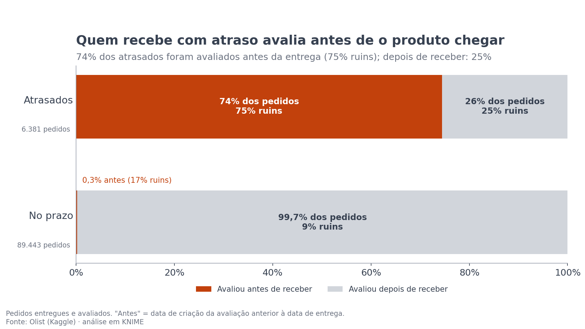
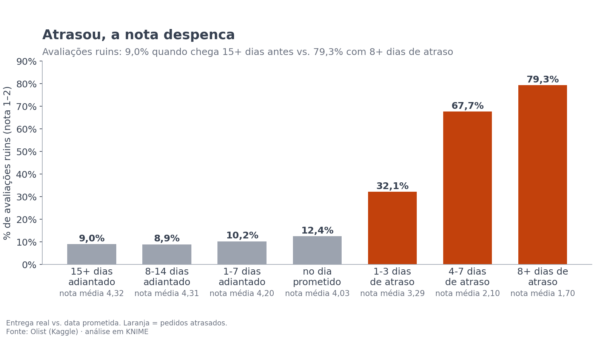
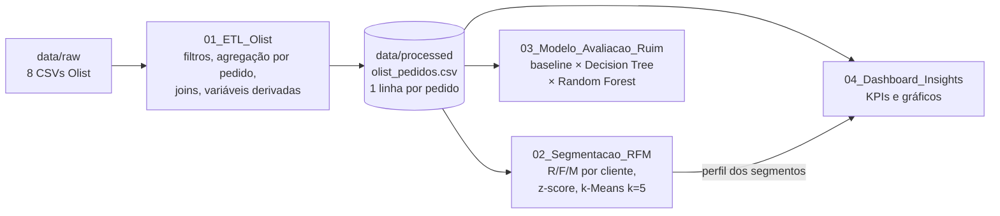
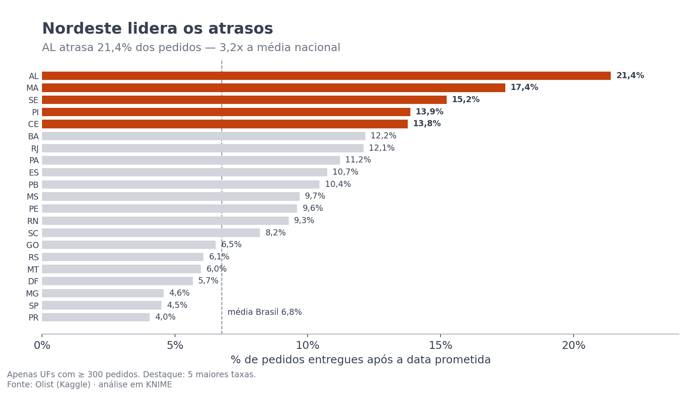
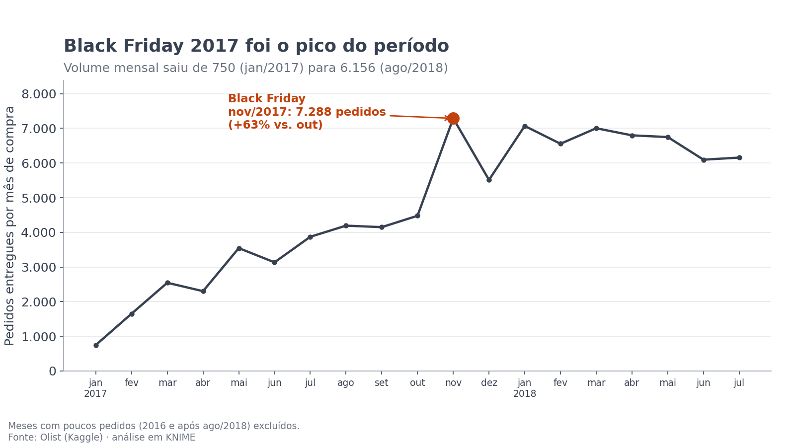
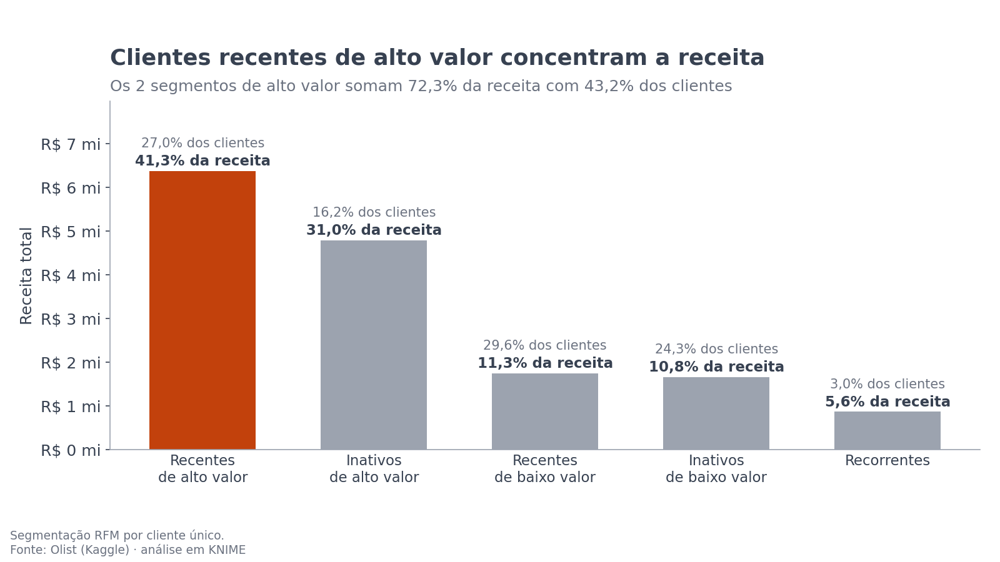
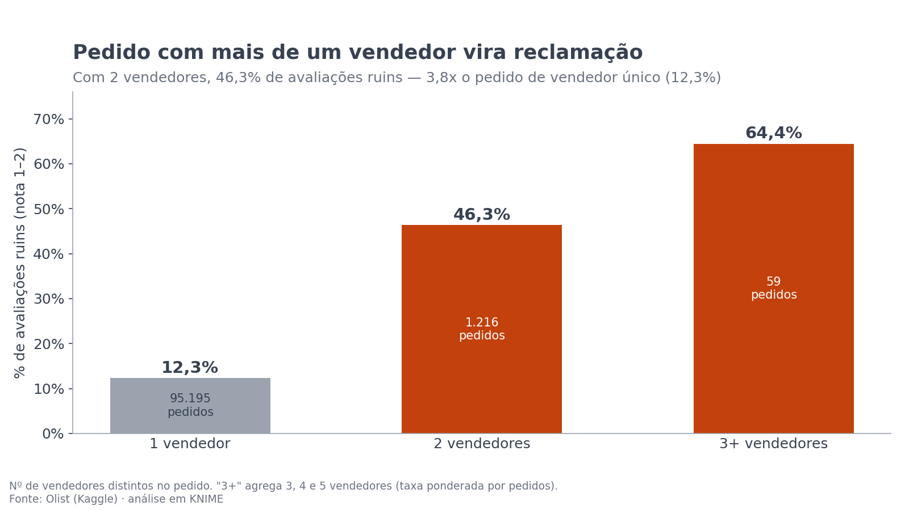
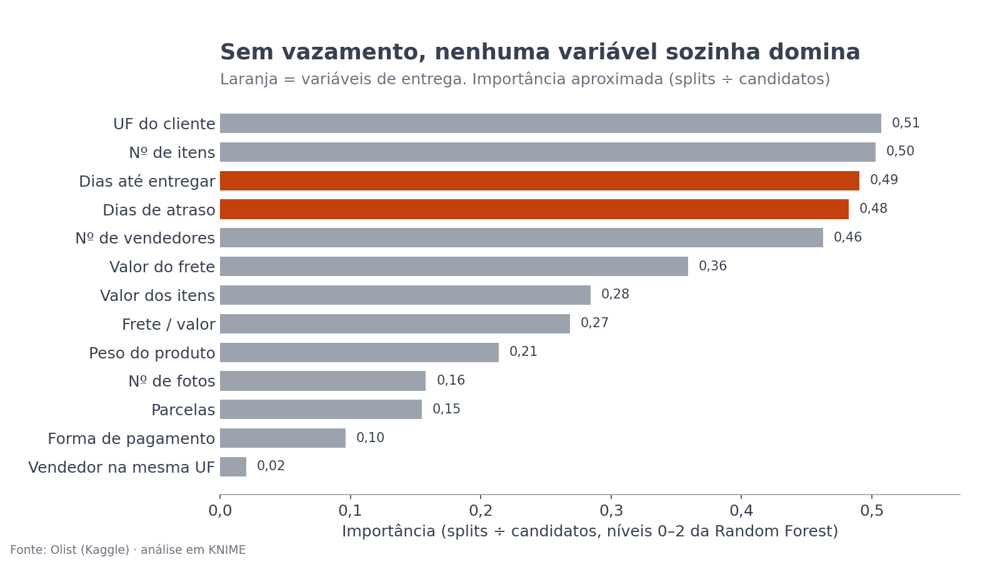
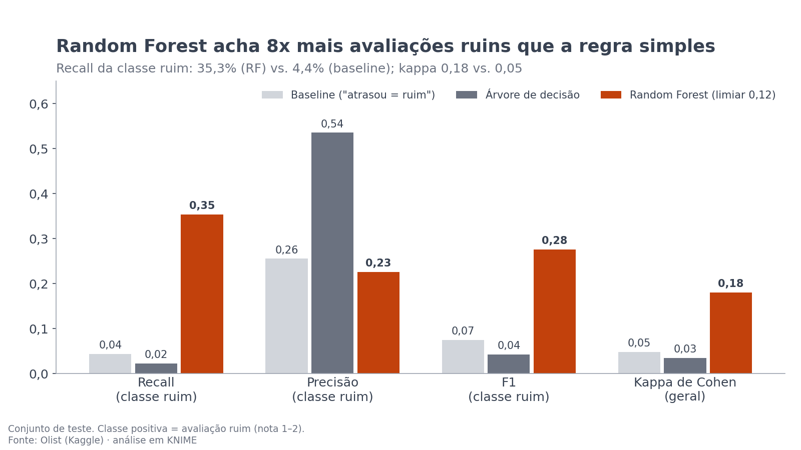

# Olist E-commerce: clientes, atrasos e avaliações ruins (KNIME)

> Pipeline analítico de ponta a ponta em **KNIME Analytics Platform 5.11** (só nós nativos, sem Python) sobre **96.470 pedidos entregues** do e-commerce brasileiro (Olist, 2016–2018). Inclui ETL, segmentação RFM com k-Means, modelo preditivo de avaliação ruim e painel de indicadores.

## Principais insights

1. **Atraso é o que mais derruba a nota.** Só 6,8% dos pedidos atrasaram, mas entre eles **62% das avaliações são ruins (nota 1–2)**, contra 9% nos pedidos entregues no prazo. Com 8 dias ou mais de atraso, a taxa de avaliações ruins chega a 79,3% e a nota média cai para **1,70**.
2. **Quem recebe com atraso avalia antes de o produto chegar.** **74%** dos pedidos atrasados foram avaliados *antes* da entrega, e 75% dessas avaliações são ruins. Das 4.976 avaliações feitas antes da entrega, 94% foram criadas na data prometida ou depois dela. Isso indica que a pesquisa de satisfação sai perto da data prometida, e o cliente atrasado avalia enquanto ainda espera. Quando a avaliação é feita depois de receber, a taxa de nota ruim do pedido atrasado cai para 25%.
   - **Recomendação 1:** disparar a pesquisa na **entrega confirmada**, e não na data prometida.
   - **Recomendação 2:** avisar **antes do prazo** os clientes cujo pedido corre risco de atrasar.
3. **97% dos clientes compraram uma única vez.** O segmento **"Inativos de alto valor"** reúne 16% dos clientes e **31% da receita**. São clientes de ticket alto (R$ 317 em média) que não compram há mais de um ano, por isso são o alvo de reativação.
4. **Prever a avaliação ruim só com dados pós-entrega é difícil, mas ajuda a priorizar.** Sem vazamento, o Random Forest sinaliza 15% dos pedidos e, entre eles, encontra **35% das avaliações ruins**. É 8 vezes o que acha a regra "atrasou = ruim" (4%). A AUC é modesta (0,66): o modelo serve como **lista de triagem**, não como oráculo.

| Avaliação antes da entrega | Nota média por faixa de entrega |
|---|---|
|  |  |

## O problema de negócio

Um marketplace perde receita de dois jeitos silenciosos: clientes que compram uma vez e não voltam, e pedidos que viram avaliação de 1 ou 2 estrelas e derrubam a reputação dos vendedores. O projeto responde três perguntas:

- **Onde a operação falha?** Atraso por UF, por faixa e por mês, e o momento da avaliação.
- **Quais clientes valem retenção?** Segmentação RFM com k-Means.
- **Dá para sinalizar, na entrega, os pedidos com risco de avaliação ruim?**

### O que mudou em relação ao projeto anterior (Tableau)

| | Projeto anterior (Tableau) | Este projeto (KNIME) |
|---|---|---|
| Tipo de análise | Descritiva (painéis) | Descritiva + segmentação + modelo preditivo |
| Definição de atraso | Data/hora da entrega > data prometida. Como a data prometida não tem hora, entregas **no próprio dia** contavam como atraso | **Data** da entrega > **data** prometida. Corrige 1.292 pedidos: a taxa cai de 8,1% para **6,8%** |
| Clientes | Por `customer_id` (1 id por pedido) | Por `customer_unique_id` (cliente real) |
| Atraso × nota | Correlação | Mostra *quando* o cliente avalia (antes da entrega) e remove esse vazamento do modelo |
| Saída | Gráficos | Segmentos com ação recomendada + lista de pedidos de risco |

## Arquitetura



## Dataset

**Brazilian E-Commerce Public Dataset by Olist**, disponível no [Kaggle](https://www.kaggle.com/datasets/olistbr/brazilian-ecommerce). São dados reais e anonimizados de ~100 mil pedidos (2016–2018).

O ETL usa 8 das 9 tabelas: orders, order_items, order_payments, order_reviews, customers, products, sellers e category_name_translation. A tabela de geolocalização não é usada. Licença: CC BY-NC-SA 4.0.

## Métodos

**01_ETL_Olist** (96.470 linhas, uma por pedido)
- `CSV Reader` → `Row Filter` (só pedidos `delivered` com data de entrega) → `String Manipulation` + `String to Date&Time` → `Date&Time Difference` (`delivery_days`, `delay_days`).
- Itens e pagamentos são agregados por pedido **antes** dos joins (`GroupBy`), para não duplicar linhas. Avaliações: 1 por pedido, a mais recente (`Sorter` + `Duplicate Row Filter`), com a data de criação.
- `Joiner` encadeado: pedido ⇄ cliente ⇄ itens ⇄ pagamentos ⇄ avaliação ⇄ produto ⇄ vendedor principal.
- `Rule Engine` e `Math Formula` criam as variáveis:
  - `delivery_status`: atrasado se `delay_days > 0`;
  - `review_class`: ruim = nota 1–2, boa = 3–5;
  - `freight_ratio`: frete ÷ valor dos itens;
  - `same_state`: vendedor na mesma UF do cliente;
  - `n_sellers` e `category`.

**02_Segmentacao_RFM** (93.349 clientes, data de referência 2018-08-30)
- `GroupBy` por `customer_unique_id` calcula a última compra, o nº de pedidos e o valor pago total.
- Como 97% compraram só uma vez, **F vira binária** (1 compra × 2 ou mais) e **M recebe log** (`ln(M+1)`).
- Em seguida, `Normalizer` (z-score) e `k-Means` (k=5, semente 42).
- Os nomes dos segmentos saem de **regras sobre as médias de cada cluster** (Rule Engine):
  - **recorrente**: mais da metade dos clientes recomprou;
  - **recente**: recência média abaixo de 250 dias;
  - **alto valor**: valor médio de pelo menos R$ 150.

| Segmento | Clientes | % clientes | Receita | % receita | Ticket médio | Recência média | Ação recomendada |
|---|---:|---:|---:|---:|---:|---:|---|
| Recentes de alto valor | 25.206 | 27,0% | R$ 6,37 mi | 41,3% | R$ 253 | 127 dias | Incentivar 2ª compra (cupom pós-entrega) |
| **Inativos de alto valor** | 15.086 | 16,2% | R$ 4,78 mi | **31,0%** | R$ 317 | 382 dias | Campanha de reativação personalizada |
| Recentes de baixo valor | 27.587 | 29,6% | R$ 1,74 mi | 11,3% | R$ 63 | 134 dias | Upsell / frete grátis acima de um valor |
| Inativos de baixo valor | 22.669 | 24,3% | R$ 1,66 mi | 10,8% | R$ 73 | 396 dias | Baixa prioridade: e-mail de baixo custo |
| Recorrentes | 2.801 | 3,0% | R$ 0,86 mi | 5,6% | R$ 309 (2,11 pedidos) | 221 dias | Programa de fidelidade e cross-sell |

Os dois segmentos de alto valor somam 72,3% da receita com 43,2% dos clientes.

**03_Modelo_Avaliacao_Ruim**
- **Alvo:** `review_class` (ruim × boa).
- **Sem vazamento:** os 4.976 pedidos avaliados **antes da entrega** são excluídos. Sobram 90.848 pedidos, dos quais 9,5% são "ruim".
- **Variáveis** (13, todas conhecidas no momento da entrega): `delay_days`, `delivery_days`, `freight_value`, `freight_ratio`, `items_value`, `n_items`, `n_sellers`, `installments`, `payment_type`, `same_state`, `customer_state`, `product_photos_qty`, `product_weight_g`.
- **Valores ausentes:** `Missing Value` (mediana para números, valor mais frequente para texto).
- **Partição:** dois `Partitioning` estratificados, 60/20/20 (treino / validação / teste), semente 42. O teste tem 18.170 pedidos.
- **Limiar:** o do Random Forest é escolhido na **validação**, pelo maior F1 da classe "ruim" (resultado: **0,12**). As métricas abaixo vêm só do **teste**. Não houve reamostragem: o desbalanceamento é tratado pelo limiar.
- **Abordagens comparadas:**
  - (a) baseline "atrasou ⇒ ruim";
  - (b) `Decision Tree Learner` (poda MDL, mínimo de 200 registros por nó);
  - (c) `Random Forest Learner` (100 árvores, semente 42).
- **Avaliação:** `Scorer`.

| Modelo (classe "ruim", conjunto de teste) | Recall | Precisão | F1 | Kappa |
|---|---:|---:|---:|---:|
| Baseline "atrasou ⇒ ruim" | 4,4% | 25,5% | 0,075 | 0,05 |
| Decision Tree | 2,2% | 53,5% | 0,042 | 0,03 |
| **Random Forest (limiar 0,12)** | **35,3%** | 22,6% | **0,275** | **0,18** |

- **AUC do Random Forest:** 0,655 no teste (0,660 na validação).
- **Precisão em contexto:** 22,6% é 2,4 vezes a taxa base de 9,5%. Ou seja, cada contato feito a partir da lista tem 2,4 vezes mais chance de atingir um cliente insatisfeito.
- **Por que a baseline desaba:** a ligação atraso → nota ruim acontece, em grande parte, *antes* da entrega (insight 2). Removido esse vazamento, restam só 1.630 pedidos atrasados avaliados depois de receber.
- **Acurácia não serve de métrica:** responder sempre "boa" acertaria 90,5%.

**Trade-off do limiar** (Random Forest, conjunto de teste):

| Limiar P(ruim) | Recall | Precisão | F1 | % dos pedidos sinalizados |
|---:|---:|---:|---:|---:|
| 0,08 | 55,5% | 15,1% | 0,238 | 35,0% |
| 0,10 | 40,3% | 19,5% | 0,263 | 19,7% |
| **0,12 (escolhido na validação)** | **35,3%** | **22,6%** | **0,275** | **14,9%** |
| 0,15 | 30,1% | 26,3% | 0,281 | 10,9% |
| 0,20 | 22,9% | 29,5% | 0,257 | 7,4% |
| 0,30 | 7,8% | 42,7% | 0,132 | 1,7% |

**Importância** (proxy do Random Forest: splits ÷ candidatos nos 3 primeiros níveis): UF do cliente (0,51), nº de itens (0,50), dias até entregar (0,49), dias de atraso (0,48) e nº de vendedores (0,46). Nenhuma variável domina sozinha.

> A AUC e a tabela de limiares são calculadas a partir das probabilidades que o workflow exporta (`previsoes_validacao.csv` e `previsoes_teste.csv`).

**04_Dashboard_Insights**: `GroupBy` + `Rule Engine` (faixas de atraso) + `Bar Chart` geram os KPIs gerais e visões por faixa de entrega, UF, mês (jan/2017 a jul/2018), categoria, nº de vendedores e segmento RFM.

## Mais resultados

- **Visão geral:** 96.470 pedidos entregues · 93.349 clientes · receita (valor pago) de R$ 15,4 mi · ticket médio de R$ 160 · nota média de 4,16 · entrega em 12,5 dias, em média.
- **UF:** o atraso se concentra no Nordeste. Alagoas tem 21,4% de pedidos atrasados (3,2 vezes a média), seguido de MA, SE, PI e CE (UFs com pelo menos 300 pedidos). Em SP, a taxa é de 4,5%. O RJ tem 12.350 pedidos, com 12% de atraso e 18% de avaliações ruins.
- **Sazonalidade:** o pico de volume foi em nov/2017 (Black Friday), com 7.288 pedidos, 63% a mais que em outubro. O pior mês em atraso foi mar/2018 (19%).
- **Sinal a investigar: pedidos com mais de um vendedor.** Com 2 vendedores (1.216 pedidos), 46,3% das avaliações são ruins, contra 12,3% com 1 vendedor. Pode ser efeito da entrega dividida, mas também pode ser em parte um artefato dos dados: uma avaliação por pedido cobre os envios de vários vendedores. Pedidos com 3 ou mais vendedores são só 59.

| Atraso por UF | Pedidos por mês |
|---|---|
|  |  |

| Receita por segmento | Vendedores por pedido |
|---|---|
|  |  |

| Importância das variáveis | Comparação dos modelos |
|---|---|
|  |  |

## Limitações

- **Boa parte da insatisfação não está nos dados.** Mesmo no prazo, 9% das avaliações são ruins. Qualidade do produto, expectativa frente ao anúncio e atendimento não aparecem nas tabelas, por isso a AUC fica em 0,66.
- **A data da avaliação só tem dia, sem hora.** Avaliações feitas no próprio dia da entrega contam como "depois".
- Os dados cobrem 2016–2018 e um único marketplace. Como quase todos os clientes compram uma vez, a dimensão F do RFM é limitada.

## Como reproduzir

1. Instale o [KNIME Analytics Platform 5.11](https://www.knime.com/downloads), que é gratuito. Todos os nós são nativos: não precisa de extensões nem de Python. Testado também no 5.12 LTS, com saídas idênticas.
2. Baixe um dos pacotes na página de [Releases](https://github.com/santana7o/olist-knime-portfolio/releases):
   - **`Olist_KNIME_Portfolio_com_dados.zip`** (60 MB): já traz os CSVs;
   - **`Olist_KNIME_Portfolio_sem_dados.zip`** (15,6 MB): baixe o dataset no [Kaggle](https://www.kaggle.com/datasets/olistbr/brazilian-ecommerce) e copie os CSVs para `data/raw/`, com os nomes originais.
3. No KNIME, use *File → Import KNIME Workflow…*, selecione o **zip do pacote** e importe para o seu workspace. Outra opção é descompactar o zip direto na pasta do workspace. A pasta `Olist_KNIME_Portfolio/` precisa ficar inteira.
   > Um `.knwf` importado sozinho **não encontra os dados**, porque os workflows leem `../data/raw` e `../data/processed`, relativos à própria pasta. Os `.knwf` avulsos servem só para inspecionar um workflow.
4. Execute na ordem `01_ETL_Olist` → `02_Segmentacao_RFM` → `03_Modelo_Avaliacao_Ruim` → `04_Dashboard_Insights`. O 01 grava a tabela analítica em `data/processed/`, que os demais leem.

## Estrutura

```
Olist_KNIME_Portfolio/
├── 01_ETL_Olist/
├── 02_Segmentacao_RFM/
├── 03_Modelo_Avaliacao_Ruim/
├── 04_Dashboard_Insights/
└── data/
    ├── raw/          # CSVs do Kaggle
    └── processed/    # saídas dos workflows
docs/
└── img/              # gráficos + gerar_graficos.py
```

## Próximos passos

- **Modelo de risco de atraso no momento da compra**, com UF de origem e destino, frete, peso, prazo prometido e nº de vendedores. É o que permite a comunicação proativa da recomendação 2 e ataca a causa principal das notas ruins.
- Validação cruzada (`X-Partitioner`/`X-Aggregator`), ajuste de hiperparâmetros e Gradient Boosted Trees.
- Limiar definido pelo custo real: quanto custa contatar um cliente frente a quanto custa perdê-lo.
- Análise de texto dos comentários (`Text Processing`) para explicar a insatisfação que não vem de atraso.
- Investigar pedidos com vários vendedores no nível de item/envio.

## Autor

**Felipe Santana**, estudante de BI / Big Data
- GitHub: [github.com/santana7o](https://github.com/santana7o)
